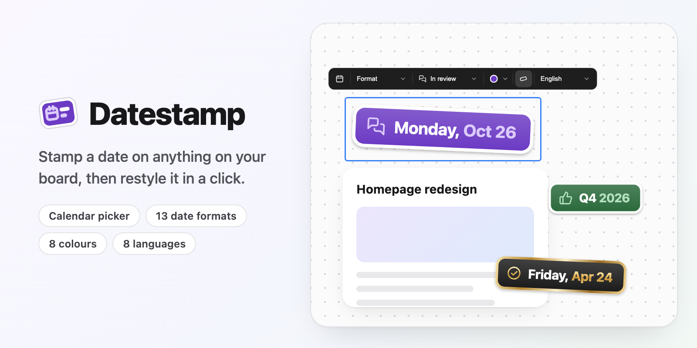

# Datestamp for Drawdy

Mark anything on your board with a date sticker: **Saturday, Oct 24**. A stamp
starts on today's date, and you can change its date, status, colour, format or
language in a click.

## What you get

- Stamps that look like stickers: a coloured badge in a white rim, with an
  icon and the date in two tones, leaning a little like they were slapped on.
- Six statuses, each with its own icon: **Date**, **Approved**, **Done**,
  **In review**, **Draft** and **Flagged**.
- Eight colours: Black, Blue, Green, Red, Purple and Orange, a Gold with a
  metallic rim and lettering, and a Rainbow.
- Thirteen ways to write the date, from `Saturday, Oct 24` and `24 Oct 2026`
  to `June`, `Q4 2026` and `2026`, in English, Thai, Japanese, Chinese,
  Korean, Spanish, French or German.
- A bar above a selected stamp to style it in a click, and a panel with a
  month calendar for the date.
- Each stamp is one image, so it moves and resizes as one, and looks the same
  on a light or a dark board, like sticky notes do.

## How to use

### 1. Add a stamp

Click the Datestamp icon. Pick a day on the calendar, or **Yesterday**,
**Today** or **Tomorrow**, and click **Add stamp** (or press ⌘↵). It lands in
the middle of your view, selected, in the look you gave your last stamp.

### 2. Style a stamp

Select a stamp and a bar appears above it:

| You click     | What happens                                   |
| ------------- | ---------------------------------------------- |
| The calendar  | Opens the panel to pick another day            |
| **Format**    | Lists the ways to write the date, by name      |
| **Status**    | Lists the statuses, each with its icon         |
| The colour    | Shows the colours to pick from                 |
| The tilt      | Leans the stamp, or straightens it             |
| **Language**  | Lists the languages to write the date in       |

With a stamp selected, the calendar changes its date too. Select several stamps
to change them all at once.

## Good to know

- The date is the day on your device's clock when you stamp it. It doesn't
  move on by itself the next day. Click **Today** to bring it up to date.
- A change redraws the stamp at its top-left corner and keeps the size you
  resized it to. It takes two presses of undo to take back.
- Each device writes the stamp in its own system font, so its lettering can
  look a touch different on another computer. The stamp keeps its size.
- Stamps from 0.1.0 become the new kind the first time you change them.
- Nothing leaves your board: Datestamp doesn't load or send anything.
